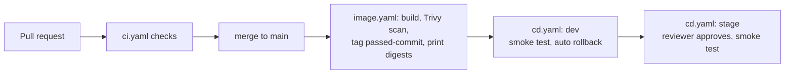

# CI/CD runbook (k3s on AWS)

Current as of `main` at `82683bb`.

How the pipeline deploys, how to check it and how to undo it. Decision: [ADR 0003](../docs/architecture/adrs/0003-k3s.md). Pipeline design: [`github-actions-plan.md`](../docs/github-actions-plan.md). Environments: [`environment-strategy.md`](../docs/environment-strategy.md). Names only below; no secret values are written in this repository.

## At a glance

| Part | What |
| --- | --- |
| Runtime | One k3s node per environment on AWS (`us-west-2`): `dev` runs `crm-dev`, `stage` runs `crm-stage`. Traefik ingress, `/api` to the API, `/` to the web app, `/actuator` not routed |
| In each namespace | `postgres` and `kafka` (StatefulSets), `crm-api` and `crm-web` (Deployments) |
| Images | `ghcr.io/<owner>/northstar-crm-backend` and `northstar-crm-frontend`, built once, deployed by digest |
| Workflows | `ci.yaml` (checks), `image.yaml` (build, scan, mark), `cd.yaml` (deploy), `infra.yaml` (Terraform validate) |
| Scripts | `scripts/cd/` (`deploy.sh`, `smoke-test.sh`, `rollback.sh` and helpers) |
| Infrastructure | `infra/terraform` creates the nodes; `infra/scripts/get-deploy-credentials.sh` prints the cluster address, CA and deploy token |



## GitHub Environments

Create `dev` (no protection) and `stage` (required reviewer, tick "Prevent self-review").

| Kind | Name | Value |
| --- | --- | --- |
| Variable | `K3S_SERVER` | `https://<elastic-ip>:6443` |
| Variable | `K8S_NAMESPACE` | `crm-dev` or `crm-stage` |
| Variable | `PUBLIC_ORIGIN` | `http://<elastic-ip>`, no trailing slash (used for CORS and the smoke test) |
| Secret | `K3S_CA_DATA`, `K3S_TOKEN` | from `get-deploy-credentials.sh` |
| Secret | `DB_PASSWORD`, `JWT_SECRET` | random per environment (`openssl rand -base64 36`); `JWT_SECRET` needs 32+ characters |
| Secret | `CRM_AGENT_PASSWORD`, `CRM_ADMIN_PASSWORD` | passwords for the demo users `agent1` and `admin1` |
| Secret (optional) | `GHCR_PULL_USER`, `GHCR_PULL_TOKEN` | only if the GHCR packages are private |

GHCR packages start private. Make both public, or add this repository under each package's "Manage Actions access" with Read; otherwise the CD `resolve` job reports the digest as `not found`.

## Deploy

1. After a merge to `main`, the Image workflow prints both digests in its job summary. If the summary is missing, read them from the commit's tags (a commit SHA is not a digest):
   ```bash
   C=<full commit sha>
   B=$(docker buildx imagetools inspect ghcr.io/<owner>/northstar-crm-backend:passed-$C  | awk '/^Digest:/{print $2}')
   F=$(docker buildx imagetools inspect ghcr.io/<owner>/northstar-crm-frontend:passed-$C | awk '/^Digest:/{print $2}')
   ```
2. Run CD, by hand or from the CLI:
   ```bash
   gh workflow run cd.yaml --ref main -f environment=dev -f backend_digest=$B -f frontend_digest=$F
   gh run watch
   ```
3. Run it again with `-f environment=stage` and the same digests. A second member approves the run.

A tag `v*` on a commit that passed the Image workflow deploys its `passed-<commit>` images to dev. CD uses the workflow file and `scripts/cd/*` of the branch chosen in "Use workflow from".

`cd.yaml` checks the digests exist, applies config, then Postgres and Kafka, then the application, verifies the running images equal the digests, and runs `smoke-test.sh`.

## Smoke test (green means)

Pods ready; web app served; guest list shows Amina Khan; no token gives 401; login as `agent1` returns a token and a customer read echoes `X-Correlation-Id: lab-request-001`; the API log contains `corr=lab-request-001`; `/actuator` is not reachable from outside.

## Roll back

- **Automatic.** A failed rollout, image check or smoke test runs `scripts/cd/rollback.sh` (`kubectl rollout undo` for `crm-api` and `crm-web`). The run still ends red.
- **Manual, preferred.** Run CD again with the previous good digests (in the earlier run's summary).
- **On the node.** `ssh -i <key> ubuntu@<ip>`, then `sudo kubectl -n crm-dev rollout undo deploy/crm-api` and the same for `crm-web`. Flyway migrations are not undone, so they must stay backward compatible.

## Image scanning

`image.yaml` fails on any HIGH or CRITICAL finding that has a fix. Fixable dependency findings are fixed by a version override in `backend/pom.xml`. A finding that cannot be fixed is accepted in `.trivyignore.yaml` with a reason and an expiry. The `passed-<commit>` tag is only set when both images pass.

## Operations

- **Stop and start the nodes:** `aws ec2 stop-instances` / `start-instances` for the two nodes only, selected by their Elastic IPs. The IPs, certificates and secrets stay valid.
- **Reset demo data:** scale `crm-api` to 0, run `DROP SCHEMA public CASCADE; CREATE SCHEMA public;` in `postgres-0`, scale back to 1. Flyway re-seeds.

## Troubleshooting

| Symptom | Cause |
| --- | --- |
| `digest ... not found` in `resolve` | Wrong value, or the workflow cannot read the package (see GHCR above) |
| Image job fails Trivy | Override the dependency, or accept the finding with an expiry |
| Smoke test: login returns no token | User must be `agent1`; check `CRM_AGENT_PASSWORD` in the Environment |
| CORS error in the browser | `PUBLIC_ORIGIN` does not match the address bar exactly |
| SSH `Permission denied (publickey)` | Pass the key used by Terraform with `-i` |

